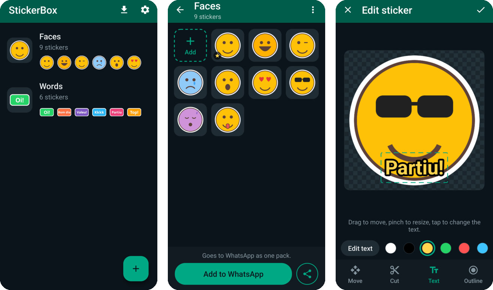

# StickerBox

Make your own WhatsApp sticker packs on Android, and keep them yours: every sticker stays on the
phone as a plain image, every pack stays editable, and WhatsApp's format is only produced when
you add or share a pack.



- **Your packs only.** No community feed, no account, no ads, no internet permission.
- **Any size.** A pack can hold any number of stickers. WhatsApp allows 30 per pack, so larger
  packs are added as "Name 1/3", "Name 2/3", ... automatically, in your sticker order.
- **Still and animated together.** Packs can mix both (see [How packs reach WhatsApp](#how-packs-reach-whatsapp)).
- **WhatsApp and WhatsApp Business.** Choose one or both each time you add a pack.
- **Editor:** move, zoom and rotate, cut as square, circle or freehand, caption with colours,
  white, black or green outline.
- **Stickers from your chats.** Browse the stickers WhatsApp keeps from your chats (and from
  its built-in packs) and add them to your packs, animated ones included.
- **Import** `.wastickers` files and images shared from any app; **export** a pack as a folder
  of images or as `.wastickers`.
- **Backup and restore** of all packs as one `.zip` with the original images.

## How it works

### Packs are folders of images

Each pack is a folder in the app's private storage:

```
packs/<id>/pack.json          name, author, order, emojis, pack icon
packs/<id>/stickers/*.png     stickers made in the editor
packs/<id>/stickers/*.webp    stickers taken as they are (from WhatsApp or .wastickers files)
```

Nothing is converted when you add a sticker. Because the app never depends on WhatsApp's copy,
an imported or restored pack is as editable as one you made.

### How packs reach WhatsApp

When you tap **Add to WhatsApp** (or share or export as `.wastickers`), StickerBox builds what
WhatsApp requires and serves it through the sticker content provider described in WhatsApp's
[sticker app documentation](https://github.com/WhatsApp/stickers/tree/main/Android):

| WhatsApp rule | What StickerBox does |
|---|---|
| 3 to 30 stickers per pack | Splits larger packs into the fewest even parts, keeping the order |
| 512 x 512 WebP | Converts editor PNGs and other images; keeps valid WebP files as they are |
| Still stickers up to 100 KB | Lossless when it fits, otherwise lossy at the highest quality that fits |
| Animated stickers up to 500 KB, 10 s, frames of at least 8 ms | Re-encodes animated stickers outside these limits (scaling, quality, then fewer frames) and caches the result |
| A pack is either all still or all animated | A part with any animated sticker is added as animated; its still stickers are sent as two identical frames, which look exactly like the still image |
| 96 x 96 PNG tray icon | Made from the sticker you mark as pack icon (or the first) |
| At least one emoji per sticker | Uses your emojis, or 😀 when none are set |

The built files live in `build/` in private storage, only the files listed for each part are
served, and the provider is readable only by apps holding WhatsApp's
`com.whatsapp.sticker.READ` permission. After you edit a pack, the app shows that WhatsApp has
the previous version until you tap **Update in WhatsApp**.

### Stickers from WhatsApp

WhatsApp stores the stickers from your chats in shared storage:

```
Android/media/com.whatsapp/WhatsApp/Media/WhatsApp Stickers/
Android/media/com.whatsapp/WhatsApp/Media/WhatsApp Backup Excluded Stickers/   (its built-in packs)
```

(`com.whatsapp.w4b/WhatsApp Business/...` for WhatsApp Business.) StickerBox reads them through
a folder you approve once in Android's file picker, so it needs no storage permission. Your
favourites list lives in WhatsApp's private database, which other apps cannot read; favourite
stickers are among the chat stickers.

### Backup format

```
stickerbox.json                    format "stickerbox-backup-1", date, default author, pack order
packs/<id>/pack.json
packs/<id>/stickers/<file>         the original images
```

Restoring adds the packs from the backup and replaces packs with the same id. Restored packs are
fully editable. Tap **Add to WhatsApp** in each pack afterwards to send it to WhatsApp again.

## Compatibility

Android 11 or newer.

| Device | Firmware | Result |
|---|---|---|
| Galaxy S10e | One UI 4.1, Android 12 | all features, WhatsApp and WhatsApp Business |

## Install

1. Download `stickerbox-<version>.apk` from the [Releases](../../releases) page and install it
   (`adb install stickerbox-<version>.apk`, or open the file on the phone).
2. Open StickerBox, tap **+** to create a pack and **Add** to add stickers.
3. The first time you open **WhatsApp stickers**, tap **Choose folder**: the picker opens at
   WhatsApp's media folder; tap **Use this folder**, then **Allow**.

## Permissions

| Permission | Why |
|---|---|
| Package visibility for `com.whatsapp` and `com.whatsapp.w4b` | whether WhatsApp is installed and has added a pack |

No internet, storage, camera or other permissions. Images come from the system photo picker
and file picker; WhatsApp's sticker folders and export folders through folders you choose.

## Build

No library dependencies; it builds with the Android SDK tools alone:

- Android SDK with build-tools and the `android-36.1` platform
- JDK 17 or newer

```
echo "sdk.dir=/path/to/Android/Sdk" > local.properties   # or export ANDROID_HOME
scripts/build.sh debug     # build/manual/app-debug.apk, debuggable, signed with the Android debug key
```

`scripts/env.sh` finds the tools: `ANDROID_HOME` or `sdk.dir`, `JAVA_HOME` or `javac` on
`PATH`, the newest installed build-tools (override with `BUILD_TOOLS`) and the
`android-36.1` platform (override with `PLATFORM`). Versions and the application ID are read
from `app/build.gradle.kts`, so the project also opens in Android Studio.

## Signing your own build

A debug build is fine for trying the app. For a build you keep and update, sign it with your
own key. The key never goes into the repository: `.gitignore` excludes `*.jks`, `*.p12` and
`*.keystore`, and the password is only typed at the prompt.

1. Create a key once, outside the repository, and keep a backup of it and its password.
   Android only installs an update over an app signed with the same key.
   ```
   keytool -genkeypair -v -keystore ~/keys/stickerbox.jks -alias stickerbox \
       -keyalg RSA -keysize 4096 -validity 10000 -dname "CN=Your Name"
   ```
2. Tell the script where it is (for example in your shell profile):
   ```
   export STICKERBOX_KEYSTORE=~/keys/stickerbox.jks
   export STICKERBOX_KEY_ALIAS=stickerbox
   ```
3. Build and sign:
   ```
   scripts/sign-release.sh    # dist/stickerbox-<version>.apk
   ```
   apksigner asks for the keystore password, then prints the certificate and the APK
   checksum.

An APK signed with your key cannot be installed over one signed with another key (such as the
release from this page). Back up your packs in **Settings**, uninstall the other build, install
yours and restore the backup.

Release notes are in [CHANGELOG.md](CHANGELOG.md).

## Disclaimer

Not affiliated with or endorsed by WhatsApp or Meta. WhatsApp is a trademark of WhatsApp LLC.
Only add stickers you have the right to use.
